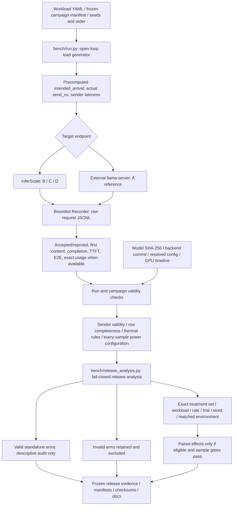
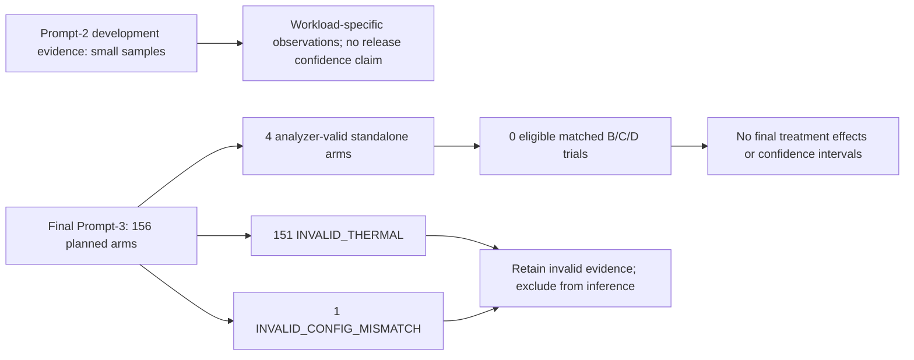
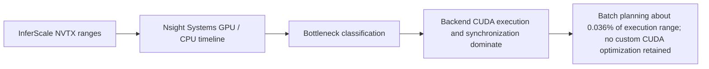

# Benchmark and release evidence architecture

Purpose: Separate measurements, validity gates, comparison eligibility and defensible claims.

What this map explains: the implemented release at `cd7daf96479044ea81237fcde8f482aae5c7dd23`. These are post-release documentation; historical ADR wording is subordinate to current source.

[Native Archify overview](archify-maps/benchmark-and-evidence-map.html) · [Master map](ARCHIFY_SYSTEM_MAP.md)

| Label | Comparison meaning |
|---|---|
| A | External unmodified llama-server, practical system reference only |
| B | InferScale FIFO, same-runtime scientific scheduler control |
| C | InferScale static SA-WDS |
| D | InferScale adaptive SA-WDS; D vs C isolates controller treatment |

These A/B/C/D labels describe comparison roles; scripts use treatment names such as `fifo`, `sawds_static` and `sawds_adaptive`. Development C2/C3/C4 labels refer to earlier configuration variants, not a new serving path.

Frozen rules: start ≤65 C, paired start spread ≤5 C, stop at 85 C or thermal slowdown, ≥90% telemetry query-row coverage, sender lateness ≤100 ms, stable default enforced GPU power in every recorded sample. Trial-1 B/C/D starts were 47/61/59 C: 14 C spread, hence incomparable. The analyzer requires at least seven complete paired trials for its nominal percentile-bootstrap interval and 10000 successful interactive TTFT observations per arm for headline p99. Neither gate was met. No matched publication-grade B/C/D inference exists because of thermal host limitations; FIFO remains the conservative default without a measured final policy win.

Separate evidence branches include deterministic lifecycle tests, sanitizer summaries, clean build/smoke, and the 20.26-minute FIFO resource soak. They establish scoped operation/safety, not scheduler treatment effects. GPU memory flattened during the soak; host RSS continued rising within the allowed drift, so an RSS plateau is not established.

## How to read this

TTFT/E2E start at intended arrival and include sender queueing. accepted_ns is client header arrival, not a server timestamp. SSE-piece intervals are not exact token ITL. Token throughput requires complete exact usage counts. Keep validity of an individual arm separate from eligibility of its paired treatment set.

## Key invariants / lessons

- Failed SLO-labelled requests stay in the attainment denominator; latency percentiles use successful requests.
- Open-loop arrivals do not wait for request completion. Recorder drops or excess sender lateness invalidate a run.
- No invalid thermal run is displayed as a final treatment effect, and a singleton is never a comparison.
- bench/analyze.py is convenience aggregation; release_analysis.py supplies fail-closed comparison gates, not an independent raw-record forensic audit.
- Bootstrap units are independent paired trials, not requests. No final interval was emitted.
- Missing/N/A thermal-reason fields are a documented telemetry limit; checksums establish indexing integrity rather than signed preregistration.

## Source anchors

- [bench/run.py](bench/run.py)
- [bench/stats.py](bench/stats.py)
- [bench/release_analysis.py](bench/release_analysis.py)
- [bench/schema/request-record.schema.json](bench/schema/request-record.schema.json)
- [bench/workloads/phase5_interactive.yaml](bench/workloads/phase5_interactive.yaml)
- [scripts/run_release_campaign.py](scripts/run_release_campaign.py)
- [scripts/run_external_reference_campaign.py](scripts/run_external_reference_campaign.py)
- [scripts/soak_release.py](scripts/soak_release.py)
- [include/inferscale/runtime/nvtx.hpp](include/inferscale/runtime/nvtx.hpp)
- [docs/BENCHMARK_METHODOLOGY.md](docs/BENCHMARK_METHODOLOGY.md)
- [docs/BENCHMARKS.md](docs/BENCHMARKS.md)
- [docs/RESUME_EVIDENCE.md](docs/RESUME_EVIDENCE.md)
- [docs/profiling/PROFILE_PHASE4.md](docs/profiling/PROFILE_PHASE4.md)
- [docs/profiling/OPTIMIZATION_EXPERIMENT.md](docs/profiling/OPTIMIZATION_EXPERIMENT.md)
- [artifacts/release-v1/manifest.json](artifacts/release-v1/manifest.json)
- [artifacts/release-v1/benchmark/final-analysis-summary.json](artifacts/release-v1/benchmark/final-analysis-summary.json)
- [artifacts/release-v1/benchmark/raw-index.json](artifacts/release-v1/benchmark/raw-index.json)
- [artifacts/release-v1/benchmark/run-validity.csv](artifacts/release-v1/benchmark/run-validity.csv)
- [artifacts/release-v1/checksums.txt](artifacts/release-v1/checksums.txt)
