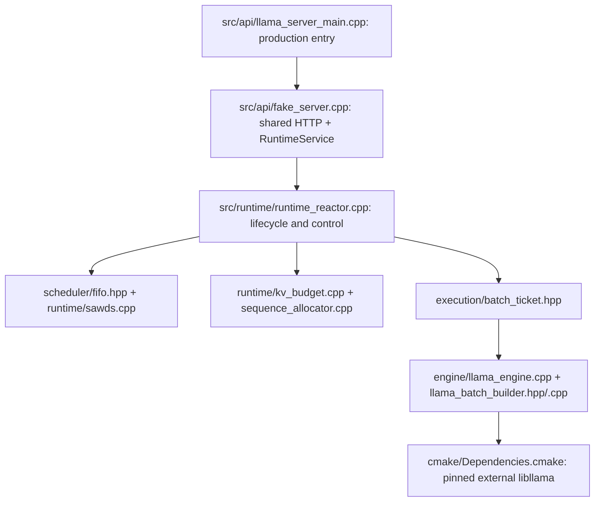
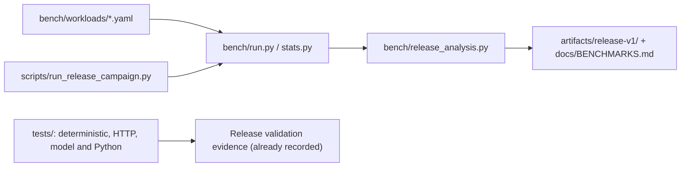

# Architecture concepts to source files

Purpose: Move from the diagrams to the exact files implementing each responsibility.

What this map explains: the implemented release at `cd7daf96479044ea81237fcde8f482aae5c7dd23`. These are post-release documentation; historical ADR wording is subordinate to current source.

[Archify source spec](archify-maps/codebase-map.json) (rendered viewer is generated locally, see [archify-maps/README.md](archify-maps/README.md)) · [Master map](ARCHIFY_SYSTEM_MAP.md)

| Concept | Header / interface | Implementation | Major tests / evidence | Relevant docs |
|---|---|---|---|---|
| RuntimeReactor / RuntimeEvent / RequestRecord | [include/inferscale/runtime/runtime_reactor.hpp](include/inferscale/runtime/runtime_reactor.hpp) | [src/runtime/runtime_reactor.cpp](src/runtime/runtime_reactor.cpp) | [tests/runtime_test.cpp](tests/runtime_test.cpp) | [docs/ARCHITECTURE.md](docs/ARCHITECTURE.md) |
| RuntimeService / single executor | [include/inferscale/api/fake_server.hpp](include/inferscale/api/fake_server.hpp) | [src/api/fake_server.cpp](src/api/fake_server.cpp) | [tests/runtime_test.cpp](tests/runtime_test.cpp) | [docs/ARCHITECTURE.md](docs/ARCHITECTURE.md) |
| RequestKey / WorkItem / WorkPlan | [include/inferscale/runtime/types.hpp](include/inferscale/runtime/types.hpp) | [src/runtime/runtime_reactor.cpp](src/runtime/runtime_reactor.cpp) | [tests/runtime_test.cpp](tests/runtime_test.cpp) | [docs/SCHEDULING.md](docs/SCHEDULING.md) |
| RequestState / lifecycle transitions | [include/inferscale/runtime/lifecycle.hpp](include/inferscale/runtime/lifecycle.hpp) | [src/runtime/lifecycle.cpp](src/runtime/lifecycle.cpp) | [tests/runtime_test.cpp](tests/runtime_test.cpp) | [docs/FAILURE_MODEL.md](docs/FAILURE_MODEL.md) |
| BatchTicket / TicketEntry | [include/inferscale/execution/batch_ticket.hpp](include/inferscale/execution/batch_ticket.hpp) | [include/inferscale/execution/batch_ticket.hpp](include/inferscale/execution/batch_ticket.hpp) | [tests/runtime_test.cpp](tests/runtime_test.cpp) | [docs/ARCHITECTURE.md](docs/ARCHITECTURE.md) |
| SequenceAllocator | [include/inferscale/runtime/sequence_allocator.hpp](include/inferscale/runtime/sequence_allocator.hpp) | [src/runtime/sequence_allocator.cpp](src/runtime/sequence_allocator.cpp) | [tests/runtime_test.cpp](tests/runtime_test.cpp) | [docs/ARCHITECTURE.md](docs/ARCHITECTURE.md) |
| KvBudgetManager / KvLease | [include/inferscale/runtime/kv_budget.hpp](include/inferscale/runtime/kv_budget.hpp) | [src/runtime/kv_budget.cpp](src/runtime/kv_budget.cpp) | [tests/policy_test.cpp](tests/policy_test.cpp); [tests/runtime_test.cpp](tests/runtime_test.cpp) | [docs/KV_ACCOUNTING.md](docs/KV_ACCOUNTING.md) |
| FIFO scientific control | [include/inferscale/scheduler/fifo.hpp](include/inferscale/scheduler/fifo.hpp) | [include/inferscale/scheduler/fifo.hpp](include/inferscale/scheduler/fifo.hpp) | [tests/runtime_test.cpp](tests/runtime_test.cpp); [tests/policy_test.cpp](tests/policy_test.cpp) | [docs/SCHEDULING.md](docs/SCHEDULING.md) |
| SA-WDS / SawdsConfig | [include/inferscale/scheduler/sawds.hpp](include/inferscale/scheduler/sawds.hpp) | [src/runtime/sawds.cpp](src/runtime/sawds.cpp) | [tests/policy_test.cpp](tests/policy_test.cpp); [tests/runtime_test.cpp](tests/runtime_test.cpp) | [docs/SCHEDULING.md](docs/SCHEDULING.md) |
| AdaptivePrefillController (conceptual role; no class) | [include/inferscale/runtime/runtime_reactor.hpp](include/inferscale/runtime/runtime_reactor.hpp) | [src/runtime/runtime_reactor.cpp](src/runtime/runtime_reactor.cpp) | [tests/runtime_test.cpp](tests/runtime_test.cpp) | [docs/ADAPTIVE_PREFILL.md](docs/ADAPTIVE_PREFILL.md) |
| InferenceEngine / EngineResult / capabilities | [include/inferscale/execution/inference_engine.hpp](include/inferscale/execution/inference_engine.hpp) | [src/engine/llama_engine.cpp](src/engine/llama_engine.cpp); [src/engine/fake_engine.cpp](src/engine/fake_engine.cpp) | [tests/llama_engine_test.cpp](tests/llama_engine_test.cpp); [tests/runtime_test.cpp](tests/runtime_test.cpp) | [docs/ARCHITECTURE.md](docs/ARCHITECTURE.md) |
| LlamaEngine / greedy sampling / UTF-8 | [include/inferscale/engine/llama_engine.hpp](include/inferscale/engine/llama_engine.hpp) | [src/engine/llama_engine.cpp](src/engine/llama_engine.cpp) | [tests/llama_engine_test.cpp](tests/llama_engine_test.cpp) | [docs/ARCHITECTURE.md](docs/ARCHITECTURE.md) |
| LlamaBatchBuilder / LlamaBatchPlan | [include/inferscale/engine/llama_batch_builder.hpp](include/inferscale/engine/llama_batch_builder.hpp) | [include/inferscale/engine/llama_batch_builder.hpp](include/inferscale/engine/llama_batch_builder.hpp); [src/engine/llama_batch_builder.cpp](src/engine/llama_batch_builder.cpp) | [tests/runtime_test.cpp](tests/runtime_test.cpp); [tests/llama_engine_test.cpp](tests/llama_engine_test.cpp) | [docs/ARCHITECTURE.md](docs/ARCHITECTURE.md) |
| HTTP / SSE / SseServer | [include/inferscale/api/fake_server.hpp](include/inferscale/api/fake_server.hpp) | [src/api/fake_server.cpp](src/api/fake_server.cpp); [src/api/llama_server_main.cpp](src/api/llama_server_main.cpp) | [tests/http_server_test.cpp](tests/http_server_test.cpp); [tests/llama_http_test.cpp](tests/llama_http_test.cpp) | [docs/FAILURE_MODEL.md](docs/FAILURE_MODEL.md) |
| StreamBuffer / BoundedQueue | [include/inferscale/runtime/stream_buffer.hpp](include/inferscale/runtime/stream_buffer.hpp); [include/inferscale/runtime/bounded_queue.hpp](include/inferscale/runtime/bounded_queue.hpp) | [include/inferscale/runtime/stream_buffer.hpp](include/inferscale/runtime/stream_buffer.hpp); [include/inferscale/runtime/bounded_queue.hpp](include/inferscale/runtime/bounded_queue.hpp) | [tests/runtime_test.cpp](tests/runtime_test.cpp) | [docs/ARCHITECTURE.md](docs/ARCHITECTURE.md) |
| FakeEngine deterministic fault/barrier testing | [include/inferscale/engine/fake_engine.hpp](include/inferscale/engine/fake_engine.hpp) | [src/engine/fake_engine.cpp](src/engine/fake_engine.cpp) | [tests/runtime_test.cpp](tests/runtime_test.cpp) | [docs/FAILURE_MODEL.md](docs/FAILURE_MODEL.md) |
| Error classifier helper (not production decode mapper) | [include/inferscale/engine/error_classifier.hpp](include/inferscale/engine/error_classifier.hpp) | [include/inferscale/engine/error_classifier.hpp](include/inferscale/engine/error_classifier.hpp) | [tests/runtime_test.cpp](tests/runtime_test.cpp) | [docs/FAILURE_MODEL.md](docs/FAILURE_MODEL.md) |
| Metrics / bounded controller trace | [include/inferscale/runtime/runtime_reactor.hpp](include/inferscale/runtime/runtime_reactor.hpp) | [src/runtime/runtime_reactor.cpp](src/runtime/runtime_reactor.cpp); [src/api/fake_server.cpp](src/api/fake_server.cpp) | [tests/runtime_test.cpp](tests/runtime_test.cpp); [tests/http_server_test.cpp](tests/http_server_test.cpp) | [docs/SCHEDULING.md](docs/SCHEDULING.md) |
| NVTX / profiling | [include/inferscale/runtime/nvtx.hpp](include/inferscale/runtime/nvtx.hpp) | [src/runtime/runtime_reactor.cpp](src/runtime/runtime_reactor.cpp); [src/engine/llama_engine.cpp](src/engine/llama_engine.cpp) | [CMakeLists.txt](CMakeLists.txt) (build wiring; not a profiling test) | [docs/profiling/PROFILE_PHASE4.md](docs/profiling/PROFILE_PHASE4.md) |
| Benchmark load generator / Recorder | [bench/schema/request-record.schema.json](bench/schema/request-record.schema.json) (record contract) | [bench/run.py](bench/run.py); [bench/stats.py](bench/stats.py); [bench/sweep.py](bench/sweep.py); [bench/analyze.py](bench/analyze.py) | [tests/test_bench.py](tests/test_bench.py) | [docs/BENCHMARK_METHODOLOGY.md](docs/BENCHMARK_METHODOLOGY.md) |
| Release campaign / model and GPU configuration gates | [bench/workloads/phase5_interactive.yaml](bench/workloads/phase5_interactive.yaml) (workload contract) | [scripts/run_release_campaign.py](scripts/run_release_campaign.py); [scripts/run_external_reference_campaign.py](scripts/run_external_reference_campaign.py) | [tests/test_release_campaign.py](tests/test_release_campaign.py) | [docs/BENCHMARK_METHODOLOGY.md](docs/BENCHMARK_METHODOLOGY.md) |
| Release analysis / paired eligibility | [bench/schema/request-record.schema.json](bench/schema/request-record.schema.json) (record contract) | [bench/release_analysis.py](bench/release_analysis.py) | [tests/test_release_analysis.py](tests/test_release_analysis.py) | [docs/BENCHMARKS.md](docs/BENCHMARKS.md) |
| Resource soak / drain verification | [scripts/soak_release.py](scripts/soak_release.py) (Python module; no C++ header) | [scripts/soak_release.py](scripts/soak_release.py) | [tests/test_soak_release.py](tests/test_soak_release.py) | [docs/RESOURCE_SOAK.md](docs/RESOURCE_SOAK.md) |
| Build / pin / clean reproduction | [CMakePresets.json](CMakePresets.json) (configuration; no C++ header) | [CMakeLists.txt](CMakeLists.txt); [cmake/Dependencies.cmake](cmake/Dependencies.cmake); [scripts/reproduce_release.sh](scripts/reproduce_release.sh) | [artifacts/release-v1/test-summary.json](artifacts/release-v1/test-summary.json) (retained evidence) | [docs/REPRODUCTION.md](docs/REPRODUCTION.md) |

## How to read this

Use the table as a file-opening index. Header-only implementations appear in both columns. Python modules have no C++ header; their record/configuration contracts are labelled explicitly. Despite its filename, fake_server.cpp implements the shared production HTTP adapter and RuntimeService; FakeRuntimeService is only the fake backend specialization.

## Key invariants / lessons

- Names and paths are taken from the final repository, not the original design plan.
- AdaptivePrefillController is a conceptual role in RuntimeReactor, not a separate class or source file.
- LlamaBatchBuilder::build is header-defined; populate_llama_batch is in the .cpp file.
- Existing ADR-002 contains historical pending-adapter and generation-retention wording; current source and ARCHITECTURE.md define the implemented behavior.
- Build trees and model files are external/ignored. No runtime source, tests, release artifacts or tags were changed by these maps.

## Source anchors

- [README.md](README.md)
- [CMakeLists.txt](CMakeLists.txt)
- [CMakePresets.json](CMakePresets.json)
- [cmake/Dependencies.cmake](cmake/Dependencies.cmake)
- [docs/ARCHITECTURE.md](docs/ARCHITECTURE.md)
- [docs/ADR/ADR-001-direct-libllama.md](docs/ADR/ADR-001-direct-libllama.md)
- [docs/ADR/ADR-002-single-owner-reactor.md](docs/ADR/ADR-002-single-owner-reactor.md)
- [docs/ADR/ADR-003-logical-kv-accounting.md](docs/ADR/ADR-003-logical-kv-accounting.md)
- [docs/ADR/ADR-004-sa-wds.md](docs/ADR/ADR-004-sa-wds.md)
- [docs/ADR/ADR-005-bounded-adaptive-prefill.md](docs/ADR/ADR-005-bounded-adaptive-prefill.md)
- [artifacts/release-v1/manifest.json](artifacts/release-v1/manifest.json)
