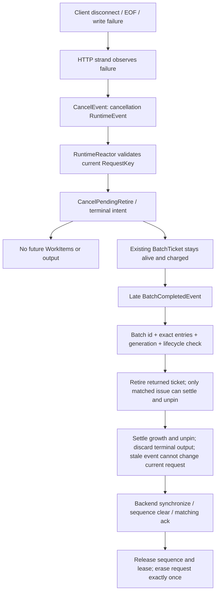
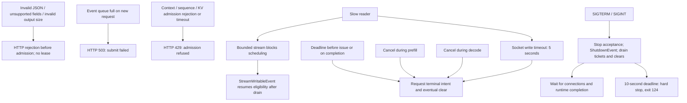

# Failure, cancellation and shutdown

Purpose: Show terminal intent, stale-event fences and the limits of recovery.

What this map explains: the implemented release at `cd7daf96479044ea81237fcde8f482aae5c7dd23`. These are post-release documentation; historical ADR wording is subordinate to current source.

[Native Archify overview](archify-maps/failure-and-cancellation-map.html) · [Master map](ARCHIFY_SYSTEM_MAP.md)

`RequestKey = request id + generation`. The reactor retains accepted generation history. An old completion/cancel cannot mutate a newer incarnation of the same ID. Duplicate completion must also match the issued batch ID and exact ticket entries: generation alone is insufficient. HTTP uses monotonic IDs and generation 1; general reactor reuse advances generation. There is no reusable HTTP request-slot pool, and generation history is currently unbounded.

| Taxonomy | Actual behavior |
|---|---|
| `RequestRecoverable` | Backend failure applies to every request represented by the returned ticket; retire and clear those sequences; service can continue if clears succeed. Pinned decode statuses 1 and -1 map here. |
| `EngineRecoverable` | Contract and FakeEngine injection support; affected ticket requests fail and clear. Production LlamaEngine does not currently emit it. |
| `EngineRestartRequired` | Other nonzero decode statuses, decode-state mismatch or postprocessing invariant: fail all runtime work, stop admission, unhealthy health/readiness. External restart required. |
| `ProcessFatal` | Uncaught backend exception or fatal runtime/clear invariant; conservatively fail all and stop admission. The HTTP process remains alive until external restart or shutdown. |

The generic `classify_engine_error()` is a tested helper, not the mapper used by production LlamaEngine. Unknown helper statuses are conservatively fatal. Restart-required and process-fatal classifications **do not implement automatic engine restart or automatic process exit**. A failed clear quarantines resources and prevents clean drain.

## How to read this

Terminal intent is an immediate scheduling/output fence, not immediate deallocation. The late-completion branch explains why cancelling during either prefill or decode is safe. Rejected/stale events have no authority over a current request.

## Key invariants / lessons

- Request-state mutation stays on RuntimeReactor; HTTP and executor post events.
- Fatal backend status is not hidden by concurrent cancellation.
- A stale completion cannot retire a newer ticket or release a reused sequence.
- Slow sockets do not block the backend executor on socket I/O.
- Production uses a 4096-byte stream; small 186-byte test capacity is a test setting.
- Generation-history compaction and automatic restart are unsupported. The 10-second hard-stop failure branch is implemented but was not deliberately fault-injected.

## Source anchors

- [src/api/fake_server.cpp](src/api/fake_server.cpp)
- [src/api/llama_server_main.cpp](src/api/llama_server_main.cpp)
- [include/inferscale/engine/error_classifier.hpp](include/inferscale/engine/error_classifier.hpp)
- [src/engine/llama_engine.cpp](src/engine/llama_engine.cpp)
- [src/runtime/runtime_reactor.cpp](src/runtime/runtime_reactor.cpp)
- [tests/runtime_test.cpp](tests/runtime_test.cpp)
- [tests/http_server_test.cpp](tests/http_server_test.cpp)
- [tests/llama_http_test.cpp](tests/llama_http_test.cpp)
- [docs/FAILURE_MODEL.md](docs/FAILURE_MODEL.md)
- [docs/LIMITATIONS.md](docs/LIMITATIONS.md)
