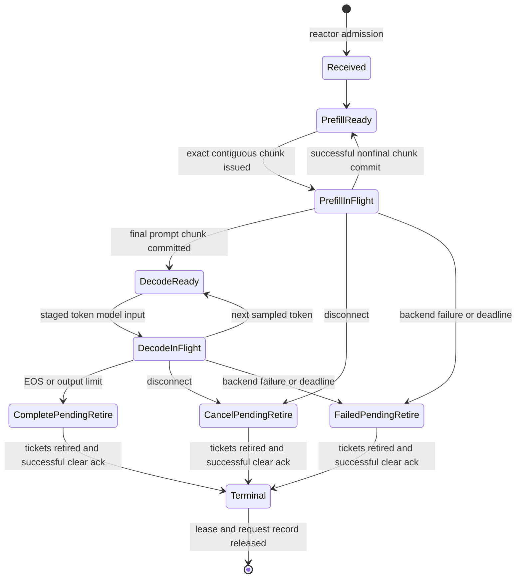
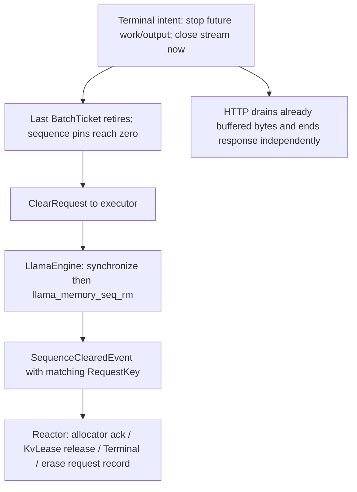

# One request: ingress to retirement

Purpose: Trace state, asynchronous ownership, output, and safe reclamation.

What this map explains: the implemented release at `cd7daf96479044ea81237fcde8f482aae5c7dd23`. These are post-release documentation; historical ADR wording is subordinate to current source.

[Native Archify overview](archify-maps/request-flow.html) · [Master map](ARCHIFY_SYSTEM_MAP.md)

```mermaid
sequenceDiagram
  participant C as Client
  participant H as HTTP strand
  participant R as RuntimeReactor
  participant T as LlamaEngine tokenizer on HTTP thread
  participant E as Backend executor / LlamaEngine
  participant L as libllama
  C->>H: POST /v1/completions
  H->>H: Parse and validate strict streaming subset
  H->>H: Allocate monotonic request id
  H->>T: Direct tokenize call with vocabulary primitives
  T-->>H: Exact token IDs (shared immutable vector)
  H->>H: Form RequestKey / generation hint 1
  H->>R: NewRequestEvent with stream and admission result
  R->>R: Validate generation / context / capacity
  R->>R: Reserve KvLease, allocate sequence, own RequestRecord
  R-->>H: Accepted RequestKey = id + generation
  loop Prefill chunks then decode epochs
    R->>R: Eligibility → WorkItem → bounded WorkPlan
    R->>R: Recheck issue / authorize growth / reserve output / pin sequence
    R->>E: Move BatchTicket into bounded engine command queue
    E->>E: LlamaBatchBuilder maps ticket entries and logits
    E->>L: Construct llama_batch; llama_decode
    L-->>E: Status and logits
    E->>E: Greedy sampling / staged token / UTF-8 piece conversion
    E->>R: Move ticket back in BatchCompletedEvent + EngineResult
    R->>R: Match batch id, exact entries, generation and lifecycle
    R->>R: Retire matching ticket; settle growth; unpin sequence; commit live cursor/output
    R->>R: Enqueue pieces; evaluate backpressure and next epoch
    H->>H: Drain StreamBuffer and encode SSE
    H-->>C: Content-bearing SSE events
    H->>R: StreamWritableEvent when drained
  end
  R->>R: Terminal intent closes stream; schedule clear when pins are zero
  H-->>C: Successful end: usage SSE then [DONE]
```



Cancellation/failure may also interrupt other nonterminal states; the state diagram shows the in-flight cases. The transition helper permits `Received` to `CompletePendingRetire`, but production admission rejects zero-work requests and always enters `PrefillReady`. Admission rejection creates no serving lifecycle.



There is no separate request-slot allocator: the reactor erases the request record and retains generation history; `SequenceAllocator` owns backend sequence slots. The first sampled successor is staged at final prefill, then emitted during a decode work item. Sampling can therefore happen before that token becomes SSE output. EOS/EOG itself is not counted as an output token or submitted as a model input; an all-EOG plan can skip llama_decode because its backend batch is empty.

## How to read this

HTTP owns connection parsing and socket writes; it posts events. The reactor owns request state, allocator state, leases, scheduler credits and cursor commits. The executor temporarily owns the moved ticket and backend state; it returns an event rather than writing lifecycle state. StreamBuffer is a synchronized producer/consumer bridge.

## Key invariants / lessons

- RuntimeReactor is the single request-state writer.
- A WorkPlan proposal does not advance the cursor. Only successful, matching, live completion commits its exact half-open range.
- A terminal request still settles successful backend growth but suppresses cursor/output changes.
- BatchTicket retains sequence identity and immutable prompt IDs until explicit retirement; destroying an armed unretired ticket terminates.
- Backpressure suppresses scheduling; a writable event resumes eligible work. Final HTTP completion is distinct from model EOS and safe backend reclamation.

## Source anchors

- [src/api/fake_server.cpp](src/api/fake_server.cpp)
- [include/inferscale/runtime/types.hpp](include/inferscale/runtime/types.hpp)
- [include/inferscale/runtime/lifecycle.hpp](include/inferscale/runtime/lifecycle.hpp)
- [src/runtime/lifecycle.cpp](src/runtime/lifecycle.cpp)
- [src/runtime/runtime_reactor.cpp](src/runtime/runtime_reactor.cpp)
- [include/inferscale/execution/batch_ticket.hpp](include/inferscale/execution/batch_ticket.hpp)
- [src/engine/llama_engine.cpp](src/engine/llama_engine.cpp)
- [src/engine/llama_batch_builder.cpp](src/engine/llama_batch_builder.cpp)
- [tests/runtime_test.cpp](tests/runtime_test.cpp)
- [tests/llama_engine_test.cpp](tests/llama_engine_test.cpp)
- [docs/ARCHITECTURE.md](docs/ARCHITECTURE.md)
