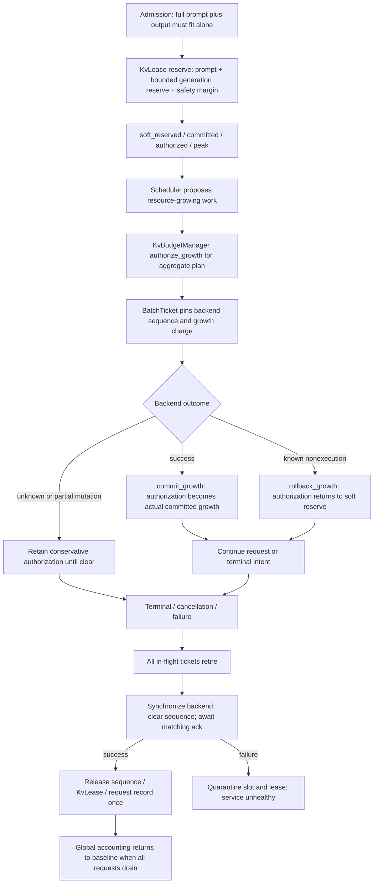
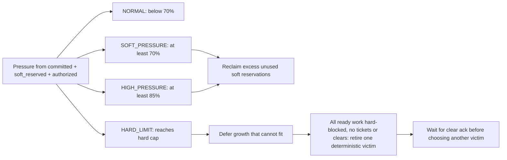

# Logical resources and sequence lifecycle

Purpose: Explain conservative accounting, growth authorization and safe release.

What this map explains: the implemented release at `cd7daf96479044ea81237fcde8f482aae5c7dd23`. These are post-release documentation; historical ADR wording is subordinate to current source.

[Native Archify overview](archify-maps/resource-lifecycle.html) · [Master map](ARCHIFY_SYSTEM_MAP.md)

InferScale's KV accounting is **LOGICAL / CONSERVATIVE RESOURCE ACCOUNTING** in sequence-token units. It is **not physical PagedAttention**. Physical KV storage and device allocations remain owned by llama.cpp.

Pressure states are observations of one ledger, not outcomes returned by `authorize_growth()`. Authorization returns a boolean. Watermarks are configurable logical thresholds. Nonempty-ledger admission must fit below the soft watermark; an empty ledger may admit its first request up to hard capacity. `/ready` follows sequence availability and normal admission pressure.

Default hard capacity is 90% of resolved aggregate context: 16 × 2048 = 32768 positions → 29491 logical tokens. Default safety margin is 16 and generation reserve is 64. These are not bytes or a physical OOM guarantee. `reconcile_committed()` can reconcile within an existing allocation with no outstanding authorization; memory estimates are not release authority.

## How to read this

Reservations are admission promises, authorization protects submitted growth, and committed tokens represent successful backend growth. These three charges share one hard cap. Cancellation changes lifecycle and reclaims unused soft reservation immediately; committed and authorized in-flight charges remain until settlement and successful backend clear acknowledgement.

## Key invariants / lessons

- Strong invariant: `committed_global + soft_reserved_global + authorized_global <= hard_usable_capacity`; therefore `committed_global <= hard_usable_capacity`.
- Priority, age and deadline cannot override hard capacity. A released or foreign lease cannot grow.
- Release occurs exactly once after matching successful clear. KvLease destruction does not release capacity.
- A sequence cannot be reused while any old BatchTicket references it, or before backend clear succeeds.
- Pressure reclamation never reduces committed occupancy. Stall retirement can terminate a request after partial streamed output.
- Clear failure keeps charges quarantined rather than pretending accounting returned to zero.

## Source anchors

- [include/inferscale/runtime/kv_budget.hpp](include/inferscale/runtime/kv_budget.hpp)
- [src/runtime/kv_budget.cpp](src/runtime/kv_budget.cpp)
- [include/inferscale/runtime/sequence_allocator.hpp](include/inferscale/runtime/sequence_allocator.hpp)
- [src/runtime/sequence_allocator.cpp](src/runtime/sequence_allocator.cpp)
- [src/runtime/runtime_reactor.cpp](src/runtime/runtime_reactor.cpp)
- [src/engine/llama_engine.cpp](src/engine/llama_engine.cpp)
- [tests/policy_test.cpp](tests/policy_test.cpp)
- [tests/runtime_test.cpp](tests/runtime_test.cpp)
- [docs/KV_ACCOUNTING.md](docs/KV_ACCOUNTING.md)
