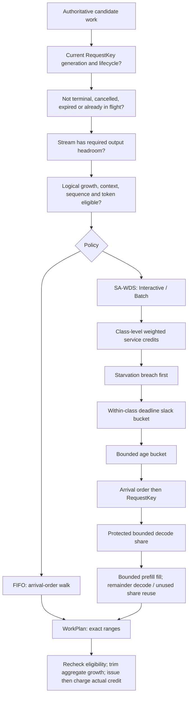
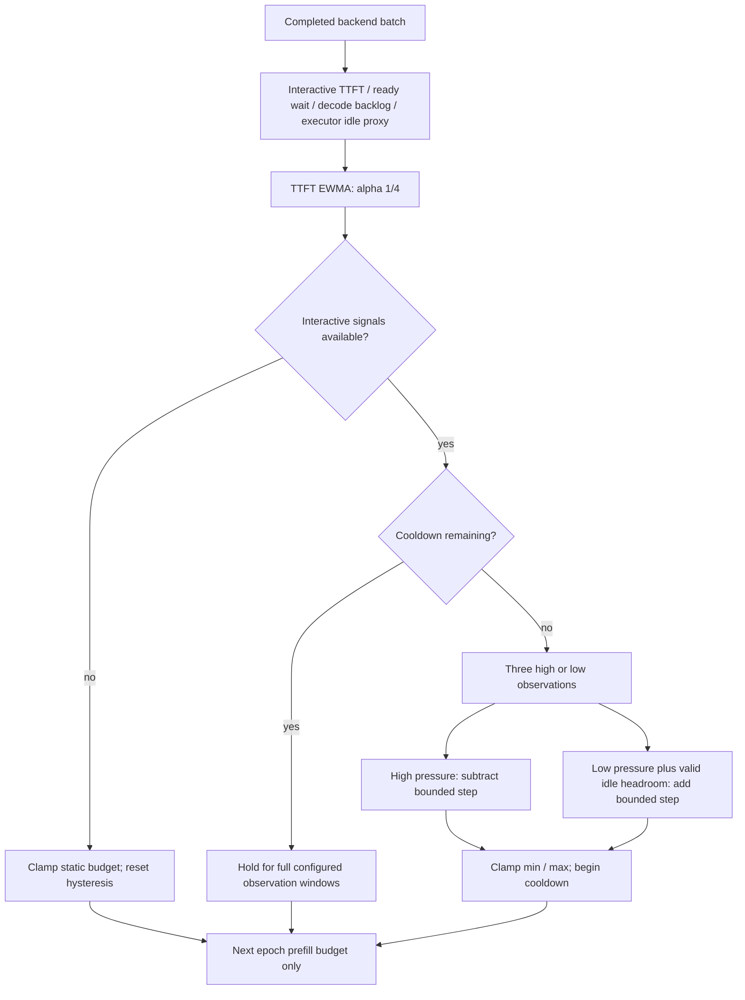

# FIFO, SA-WDS and bounded adaptive prefill

Purpose: Explain ordering after safety eligibility and the independent controller.

What this map explains: the implemented release at `cd7daf96479044ea81237fcde8f482aae5c7dd23`. These are post-release documentation; historical ADR wording is subordinate to current source.

[Archify source spec](archify-maps/scheduler-map.json) (rendered viewer is generated locally, see [archify-maps/README.md](archify-maps/README.md)) · [Master map](ARCHIFY_SYSTEM_MAP.md)

The pipeline is explanatory, not a literal chain of independent sorting passes. Within each class the urgency comparator orders starvation, deadline, age, arrival and key. Across classes normal selection favors available credit; starved candidates can override exhausted credit, while all safety bounds still apply.

| Parameter | Implemented starting default / meaning |
|---|---|
| Interactive : Batch quantum | 1024 : 256 scheduled tokens (4:1), class-level |
| Credit cap | 4096 tokens; reopen a round only after all active classes exhaust credit; idle classes discard credit |
| Aging | 1000 ms buckets, capped at 60 |
| Deadline urgency | 100 ms slack buckets, capped at 600; absent deadline sorts after deadlines |
| Starvation | 5000 ms ready wait; observable events / maximum ready wait / histograms; no hard-real-time guarantee |
| Decode protection | 25% of epoch token capacity by default, rounded upward when applicable |
| Starved prefill | Reserve one token and one sequence opportunity ahead of protected decode; normal protection resumes next plan |
| Prefill chunk ceiling | Derived from resolved backend ubatch capability (LlamaEngineConfig defaults ubatch to 512); scheduler override configurable |
| Static prefill epoch budget | RuntimeConfig defaults to 1024; bounded by batch, sequence, chunk, credit and hard-growth limits |

FIFO uses the same chunking, backpressure, context, sequence and resource bounds. It has no SA-WDS urgency/credit ordering or protected decode share.

`AdaptivePrefillController` is a conceptual label: implementation is `RuntimeReactor::observe_adaptive_prefill`, with `AdaptivePrefillConfig` and bounded trace entries. Defaults: disabled, min/max 128/2048, initial 1024, step 128, TTFT high/low 750/500 ms, backlog high/low 8/2, idle threshold 50%, three windows and five-window cooldown, 128 trace entries. Campaign settings differ and are recorded in their manifests. Executor idle is a timing proxy, not GPU utilization.

## How to read this

Read eligibility first, then policy. The scheduler proposes; the reactor is authoritative at issue. Read the controller separately: completion observations influence a later plan, never work already issued.

## Key invariants / lessons

- Adaptive control changes only a bounded scheduling budget; hard capacity stays fixed.
- Service cost is scheduled token count, not GPU-time fairness. Decode costs one; prefill costs the exact chunk length.
- Credits are charged only for successfully issued retained work, never for stale proposals.
- Missing idle data cannot trigger a budget increase; absent interactive signals trigger static fallback.
- FIFO and static control remain defaults. Final matched scheduler inference was withheld.

## Source anchors

- [include/inferscale/scheduler/fifo.hpp](include/inferscale/scheduler/fifo.hpp)
- [include/inferscale/scheduler/sawds.hpp](include/inferscale/scheduler/sawds.hpp)
- [src/runtime/sawds.cpp](src/runtime/sawds.cpp)
- [include/inferscale/runtime/runtime_reactor.hpp](include/inferscale/runtime/runtime_reactor.hpp)
- [src/runtime/runtime_reactor.cpp](src/runtime/runtime_reactor.cpp)
- [include/inferscale/api/fake_server.hpp](include/inferscale/api/fake_server.hpp)
- [include/inferscale/engine/llama_engine.hpp](include/inferscale/engine/llama_engine.hpp)
- [tests/policy_test.cpp](tests/policy_test.cpp)
- [tests/runtime_test.cpp](tests/runtime_test.cpp)
- [docs/SCHEDULING.md](docs/SCHEDULING.md)
- [docs/ADAPTIVE_PREFILL.md](docs/ADAPTIVE_PREFILL.md)
