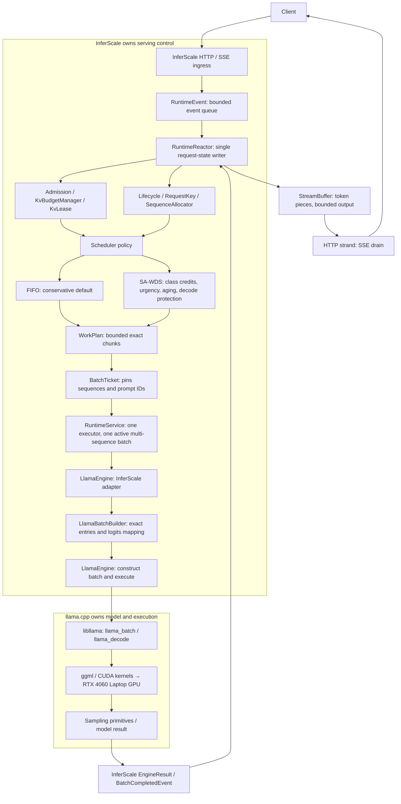
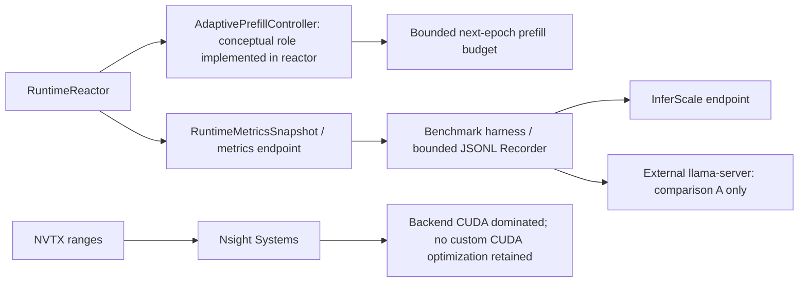

# InferScale system map

Purpose: Understand the direct single-GPU serving path and its ownership boundaries.

What this map explains: the implemented release at `cd7daf96479044ea81237fcde8f482aae5c7dd23`. These are post-release documentation; historical ADR wording is subordinate to current source.

[Native Archify overview](archify-maps/system-map.html) · [Master map](ARCHIFY_SYSTEM_MAP.md)

| InferScale owns | llama.cpp owns |
|---|---|
| HTTP/SSE, lifecycle, admission, logical budgeting, FIFO/SA-WDS, chunk policy, adaptive budget, ticket lifetime, backend failure handling, benchmark method | GGUF loading, model, physical KV storage, tokenizer primitives, `llama_batch`, `llama_decode`, ggml, CUDA kernels, sampling primitives |

External `llama-server` is never in the internal serving path. InferScale calls pinned libllama directly. The native overview groups the execution bridge; the diagram above expands the actual ticket-before-builder order.

## How to read this

Follow the first diagram downward for input and return through the reactor for output. Boxes grouped under llama.cpp are backend responsibilities, even when invoked by the InferScale adapter. The second diagram shows observation and optional control.

## Key invariants / lessons

- FIFO is the conservative default; SA-WDS and adaptive mode are available policies.
- Validation used one RTX 4060 Laptop GPU and TinyLlama-1.1B Chat Q4_K_M, with llama.cpp v0.4.1 pinned in CMake.
- Logical KV accounting is not physical PagedAttention. There is no speculative decoding, multi-GPU, distributed serving, or retained custom CUDA optimization.
- No final thermally matched publication-grade scheduler treatment effect was obtained.

## Source anchors

- [src/api/llama_server_main.cpp](src/api/llama_server_main.cpp)
- [src/api/fake_server.cpp](src/api/fake_server.cpp)
- [include/inferscale/runtime/runtime_reactor.hpp](include/inferscale/runtime/runtime_reactor.hpp)
- [src/runtime/runtime_reactor.cpp](src/runtime/runtime_reactor.cpp)
- [src/engine/llama_engine.cpp](src/engine/llama_engine.cpp)
- [src/engine/llama_batch_builder.cpp](src/engine/llama_batch_builder.cpp)
- [CMakeLists.txt](CMakeLists.txt)
- [docs/ARCHITECTURE.md](docs/ARCHITECTURE.md)
- [docs/LIMITATIONS.md](docs/LIMITATIONS.md)
